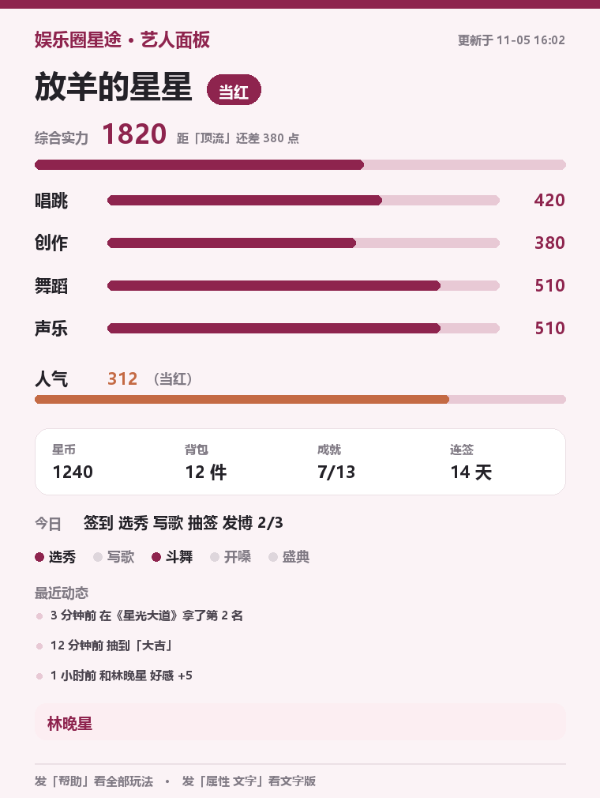
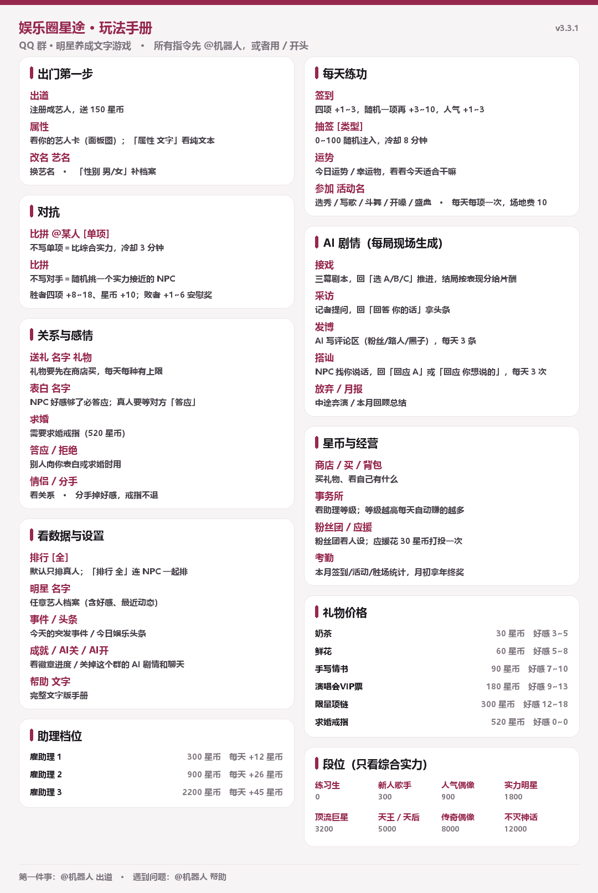

# 🎬 娱乐圈星途 · AstrBot 插件

> 一群人在 QQ 群里当明星的文字游戏：出道、抽签、接戏、发博、上热搜、谈恋爱、结婚。
> 事件、剧本、采访、舆论全部由大模型现场生成，但**数值永远由代码兜底**，模型再离谱也改不动你的段位。

<p align="center">
  
</p>

<p align="center"><sub>「属性」指令生成的艺人面板：段位、四项属性、人气、星币、成就、连签、今日待办、最近动态、伴侣</sub></p>

## 安装

### 方式一：插件市场（推荐）

AstrBot WebUI → 插件 → 插件市场 → 搜索 **娱乐圈星途** → 安装。

### 方式二：手动

```bash
cd <AstrBot 数据目录>/plugins
git clone https://github.com/<你的用户名>/astrbot_plugin_star_game.git
```

然后在 WebUI → 插件 → 重载插件（或重启 AstrBot）。

- **依赖**：无。只用 Python 标准库（`sqlite3` 等）+ AstrBot 自带的 LLM provider。
- **AstrBot 版本**：`>= 4.17.0`
- **平台**：aiocqhttp（QQ / NapCat / Lagrange）

### 先配好模型

插件本身不配 API Key，用的是 AstrBot 里当前默认的对话模型（WebUI → 服务提供商）。
模型挂了、超时、返回格式不对，插件会自动退回手写文案，**游戏不会卡住**，只是没那么好玩。

## 怎么玩

在群里 `@机器人 出道`，或者发 `/出道`。

> 群里需要 `@机器人`，或者用唤醒前缀（默认 `/`）开头。

<p align="center">
  
</p>

<p align="center"><sub>群里发「帮助」默认发的玩法手册图（两列卡片，跟着配置实时生成）</sub></p>

## 功能

原生代码是 NoneBot2 版，这里已按 AstrBot 4.x 重写命令层，游戏内核（抽签/签到/活动/比拼/段位）原样保留，并补了几块新东西：

- **AI 事件库**：事件不是写死的，由模型按需生成结构化事件（爆红/绯闻/翻车/塌房…），真的改属性和人气
- **AI 剧情线**：接戏（三幕互动剧本）、采访（评判回答）、发博（评论区舆论）、搭讪、月报
- **系统 NPC**：31 位虚拟艺人，八个段位各有人，会自动成长、上排行榜、主动约战、被表白；
  每天还有自己的小日子——接过气、翻红、翻车、谈恋爱，属性/星币/粉丝都会跟着变
- **恋爱系统**：好感度、送礼、表白、交往、分手，NPC 和真人都能谈
- **人气**：独立于实力的第二根轴，影响比拼加成和事件频率，不营业会掉
- **全图面板**：`属性` / `排行` / `明星 名字` 都是现场渲染的卡片（段位进度、四项条、人气、星币、粉丝、战绩、好感、最近动态）
- **每日娱乐头条**：每天 9:00 / 20:00 自动把 NPC 的劲爆动态挑 2~3 条播报到群里
- **25 个成就**：连签、六边形、顶流、豪门、劳模、收藏癖……达成自动解锁并播报

## 两样身家

| | 是什么 | 有什么用 |
|---|---|---|
| **实力**（唱跳/创作/舞蹈/声乐） | 四项之和＝综合实力 | 决定段位 |
| **人气** | 路人盘，0~500+ | 比拼加成（最高 +15%）、越红越容易上事件、每天不营业掉 2% |

人气称号：`查无此人 → 小有名气 → 有点热度 → 当红 → 顶流 → 国民级 → 传说`

## 玩法

| 指令 | 说明 |
|---|---|
| `出道` / `签到` / `属性` | 建号、每日成长、看面板 |
| `抽签` | 随机 0-100；前面加 `欧皇` / `反向` / `单项` 换签型 |
| `参加 选秀` | 选秀/写歌/斗舞/开嗓/盛典，每天每项一次 |
| `比拼 @某人 [单项]` | 不打人；不写对手＝随机挑战一位 NPC |
| `排行` / `排行 唱跳` / `排行 人气` / `排行 全` | 榜单出图；默认只排真人，`排行 全` 把 NPC 一起排 |
| `明星` | NPC 名单 |
| `送礼 林晚星 奶茶` | 加好感，每天限量 |
| `表白 名字` / `答应` / `拒绝` / `分手` / `情侣` | 恋爱线 |
| `明星 名字` | 任意艺人的完整档案图（含人设、好感、最近动态） |
| `成就` | 成就墙与解锁进度 |
| `事件` / `头条` | 今天出过什么事 / 今日娱乐头条 |
| `帮助` | 默认发一张总览长图；`帮助 文字` 发完整文字版 |
| `关AI` / `开AI` / `AI状态` | 群级开关：关掉后这个群只有游戏，没有 AI 聊天 |

## 群级 AI 开关

在群里 @机器人 说一句 **「关掉ai回应」**（或「关AI」「闭嘴」），这个群的大模型回应就停了，
只剩游戏指令能用；再说 **「开AI」** 恢复。支持的自然语言说法：

- 关：`关闭ai` `关掉ai` `关ai` `停止ai` `ai关闭` `ai闭嘴` `停止回应` `别说话` `闭嘴` …
- 开：`开启ai` `打开ai` `开ai` `恢复ai` `恢复回应` `可以说话了` …

实现上用的是 AstrBot 自带的**会话级 LLM 开关**（`SessionServiceManager`），所以是真的把整条大模型链路
停掉，不是靠插件拦消息——`group_chat_plus` 这类读空气的插件也会一起安静。游戏内部调模型（事件/剧本/采访）
走的是直连 provider，不受影响，所以「只玩游戏」是真的还能玩。

状态存在我们自己库里（`meta.ai_off`），重启不丢。

## 防封号（发送守卫）

QQ 侧被风控通常是这几种行为，插件在**发出去之前**统一压一遍：

| 保护 | 默认值 | 作用 |
|---|---|---|
| 每分钟条数上限 | 12 条/群 | 超了排队（最多等 5 秒），不丢消息 |
| 最小发送间隔 | 1.2 秒 | 两条消息之间强制喘口气 |
| 随机抖动 | 0.2~0.8 秒 | 不形成机器般的固定节奏 |
| 重复内容拦截 | 3 秒内同文不发 | 最容易被判刷屏的行为 |
| 超长截断 | 1200 字 | 长文在换行处截断，不触发超长风控 |
| 链接/长数字 | 自动替换 | `https://…` → `[链接]`，11 位以上数字 → `[数字]` |
| 敏感词 | 可配置 | 命中替换成 `*` |

只作用于本插件自己发的消息（不碰别的插件），全部参数在 WebUI 可调。

### AI 剧情（全是模型现场生成的）

| 指令 | 玩法 |
|---|---|
| `接戏` → `选 A/B/C` | 三幕互动剧本：AI 每幕写场景+三个选项，三幕后按你的选择写结局并给表现分与属性奖励 |
| `采访` → `回答 你的话` | 记者现场提问，AI 评判你的回答（表现分 0-10）并给出一条见报标题 |
| `发博 内容` | AI 生成评论区四条（粉丝/路人/黑子/营销号）+ 舆论倾向判定 |
| `搭讪 NPC 一句话` | NPC 按人设回你一句，涨好感；交往后更黏人 |
| `月报` | AI 根据你的段位/战绩/CP/事件写一段星途回顾 |
| `放弃` | 中断进行中的通告或采访 |

> 剧情有 30 分钟超时（可配），中途走开不会把状态卡死。

> 群里需要 `@机器人` 或者用唤醒前缀（默认 `/`）开头。

## 架构

```
astrbot_plugin_star_game/
├── main.py            # Star 插件：指令 + 事件分发 + 每日维护
├── game/
│   ├── const.py       # 数值、段位、活动、礼物、NPC 名册、剧本设定、兜底文案
│   ├── engine.py      # 纯逻辑：抽签/签到/活动/比拼/段位（可单测）
│   ├── store.py       # SQLite：档案、活动日志、事件池、关系、剧情状态
│   ├── ai.py          # LLM 封装：事件/热搜/剧本/采访/发博/台词（带超时和兜底）
│   ├── npc.py         # NPC 成长、约战、新闻
│   ├── npclife.py     # NPC 的日常：接代言/翻红/翻车/恋爱，属性与粉丝随事件涨落
│   ├── headline.py    # 每日娱乐头条：从事件流里挑劲爆的播报
│   ├── card.py        # 图片渲染：艺人面板 / 排行榜 / 艺人档案
│   ├── helpcard.py    # 图片渲染：玩法手册（两列卡片）
│   ├── content.py     # 内容池：事件、剧本、评论、文风（纯数据）
│   └── social.py      # 好感、送礼、表白、CP
├── _conf_schema.json  # WebUI 可视化配置
└── metadata.yaml
```

数据落在 `data/plugin_data/astrbot_plugin_star_game/star_game.db`，按 `group_id` 隔离。

## 为什么改数值

原本是给「大群」设计的：段位顶到 5000，排行取 TOP10，抽签冷却 5 分钟。
4 个人玩的时候：

- TOP10 榜单一半是空的 → 改成全员 + NPC 一起排
- 没人卷，段位长得慢 → 段位阈值整体上调（200→300 起，5000→12000 顶）
- 抽签 5 分钟一个人能刷穿 → 默认 8 分钟，可在配置里改
- 群里没人陪你练手 → 8 个 NPC，从 80 实力到 2200 实力都有，随时能打

全部参数在插件配置页可调，也可以直接改 `game/const.py`。

## 设计取舍

- **事件预生成**：玩家触发时才去调模型会卡 2-10 秒，所以事件先进池子（低于 4 条就在后台补），
  玩家抽到的是池子里的，响应不受模型影响
- **模型只填内容，不碰规则**：事件、剧本、采访、发博全部要求输出 JSON，属性增减由代码 clamp
  （事件 ±10、人气 ±18、结算 -5~8、发博 ±4），模型再离谱也改不动数值
- **多轮剧情用状态机**：`stories` 表按 (群, 用户, 类型) 存 step + data，超时作废；
  模型写不出下一幕就用内置的收尾，玩家不会被卡在半路
- **模型全挂也能玩**：事件、热搜、台词、剧本结算、评论区都有手写兜底

## 配置

WebUI → 插件 → 娱乐圈星途 → 配置页，所有参数可视化调（`_conf_schema.json`），常用的几个：

| 配置 | 默认 | 说明 |
|---|---|---|
| `ai_daily_cap` | 150 | 每天所有 AI 请求的上限，超了只用内置文案（0 = 不限） |
| `event_probability` / `event_daily_cap` | 20 / 4 | 每个动作触发「事件」的概率、每天最多几条 |
| `flavor_probability` | 15 | 动作后 AI 点评一句的概率 |
| `npc_talk_probability` | 8 | NPC 突然搭话的概率 |
| `ai_timeout` | 10 | 单次模型调用超时（秒），超了走兜底 |
| `group_whitelist` | 空 | 留空＝所有群都能玩；填了群号就只在这些群响应 |
| `post_daily_limit` / `chat_daily_limit` | 3 / 3 | 每人每天发博、搭讪的次数上限 |

想更省 token：把 `flavor_probability`、`event_probability`、`npc_talk_probability` 调低，或把 `ai_daily_cap` 设成 30~50。

## 数据

```
data/plugin_data/astrbot_plugin_star_game/star_game.db
```

按 `group_id` 隔离，删掉这个文件就是「重新开服」。升级不会清档（表结构只做加法）。

## 常见问题

**Q：游戏结果被拆成好几条发出来怎么办？**
比如「比拼」本该是一整块（表头 + 人气加成 + 胜者 + 败者 + 评论），结果分成 3 条消息发。
这**不是插件的锅**——游戏只发一条，是别的「分段回复」类插件或框架设置把它切了：

1. 检查 AstrBot 的 `data/cmd_config.json` → `platform_settings.segmented_reply.only_llm_result`，
   设成 **`true`**（框架就只拆 AI 聊天，不拆命令/游戏输出）；
2. 如果还开着分段类插件（自己写的 `on_decorating_result` 拆分器），让它跳过非模型结果，
   判断条件用 `result.is_model_result()`，为 `False` 就原样发。

**Q：@机器人 发指令没反应？**
按顺序排：① 群里要 `@机器人` 或用唤醒前缀（默认 `/`）；② 看 `group_whitelist` 是否限定了群号；
③ 平台侧白名单（`platform_settings.id_whitelist`）里有没有这个群；④ 日志里有没有 `[star_game] 就绪`。

**Q：必须先「出道」才能玩别的吗？**
不必须。任何指令都会自动给你建档（`store.ensure_star`），发 `属性` 也能直接看到面板。
但第一次建议先发 `出道`：会给你一句入场欢迎 + 一条「正式出道」事件，人气起步好看点。

**Q：AI 不写剧情，回的全是固定文案？**
说明模型没调通：没配 provider、超时、或当天 `ai_daily_cap` 用完了。看日志里的 `[star_game][ai]`，
临时可以把 `ai_daily_cap` 调大、`ai_timeout` 从 10 调到 20。

**Q：一个人玩会不会太孤单？**
不会。内置 31 位 NPC（73~17500 实力，八个段位都有人），会自己练功、接代言、上排行榜、约战、被表白，
还会自己谈恋爱翻车；人少也有人在。

**Q：能好几个群一起开吗？数据串不串？**
能。所有数据按 `group_id` 隔离，每个群是独立的娱乐圈；`排行`/`比拼` 也只在同群内比。

**Q：升级会清档吗？怎么重开服？**
不会，表结构只做加法。想彻底重来就删 `data/plugin_data/astrbot_plugin_star_game/star_game.db`。

**Q：会不会刷屏被风控？**
插件自带发送守卫（默认 12 条/分钟、1.2 秒间隔、重复内容拦截、超长截断、链接和长数字替换），
参数在配置页可调；它只作用于本插件自己发的消息。

**Q：每天次数用完了怎么办？**
`参加`、`发博`、`搭讪`、`抽签`、`比拼` 都有冷却或每日上限，配置页可改；
`post_daily_limit`、`chat_daily_limit`、`draw_cooldown_min` 是最常调的三个。

**Q：能在私聊里玩吗？**
不能。所有指令都要求带群号（`event.get_group_id()` 为空直接返回），排行榜和 NPC 互动也是以群为单位设计的。

## 许可

MIT，见 [LICENSE](LICENSE)。欢迎 PR，尤其是：新的 NPC 人设、事件类型、段位数值平衡。
